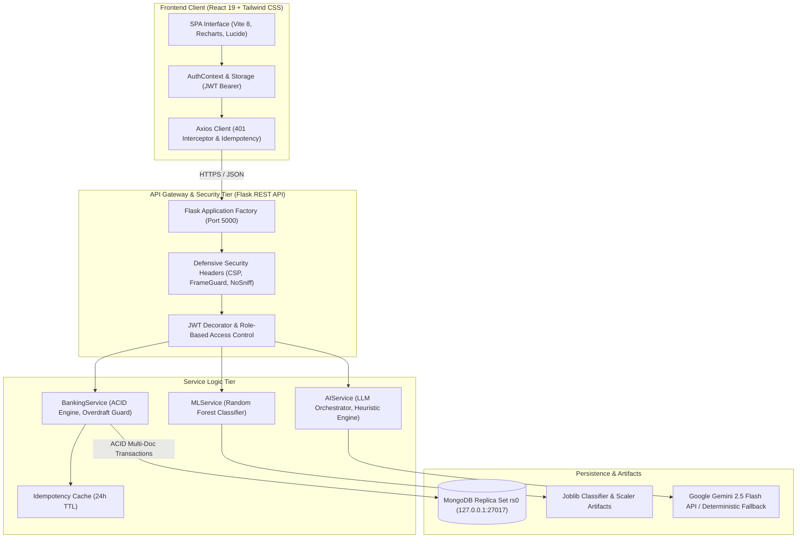
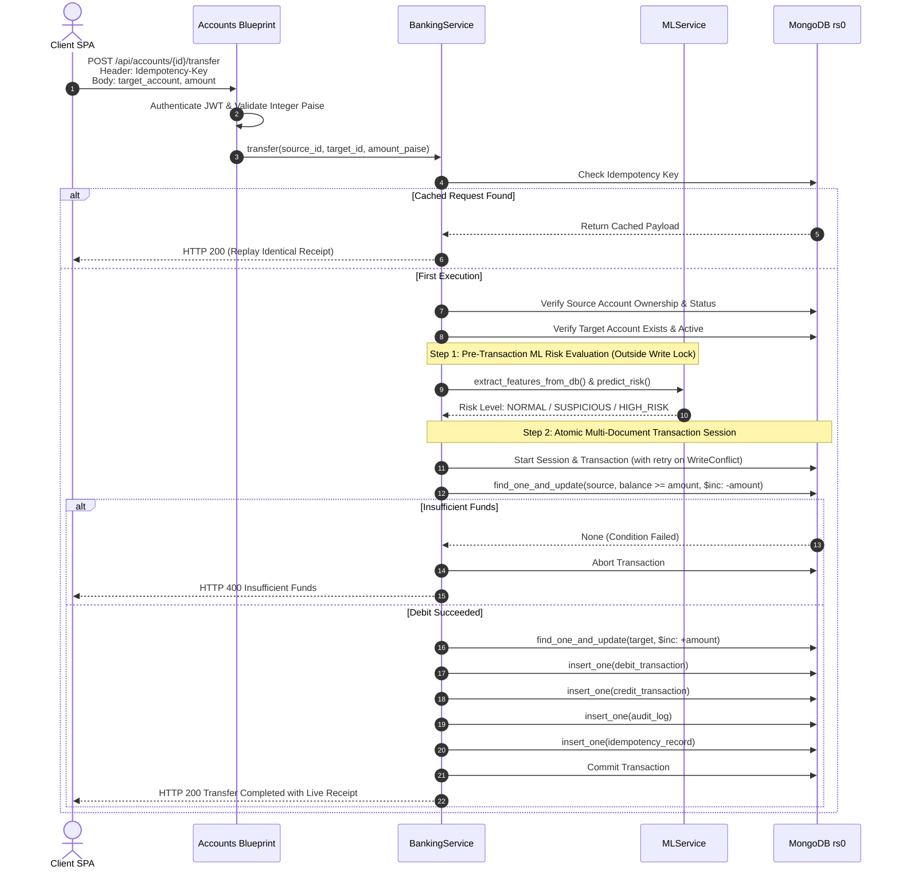
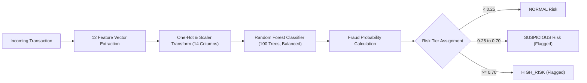
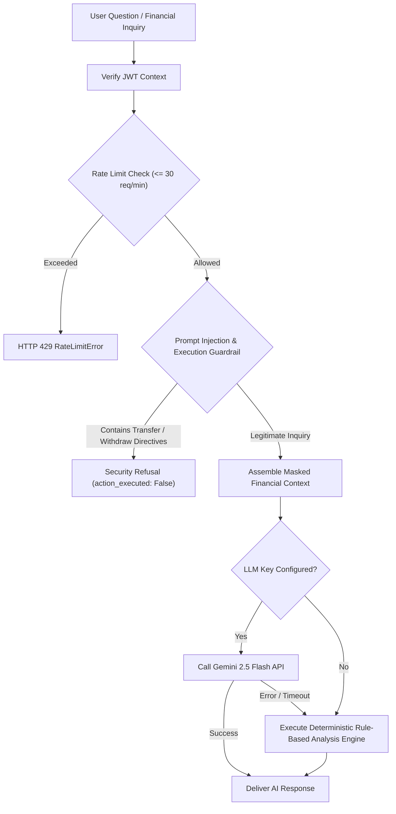

# Apex Bank: AI-Enhanced Core Banking Platform

[](https://www.python.org/)
[](https://flask.palletsprojects.com/)
[](https://www.mongodb.com/)
[](https://react.dev/)
[](https://vitejs.dev/)
[](https://tailwindcss.com/)
[]()
[]()

---

## 1. Project Overview & Objectives

**Apex Bank** is a modern, enterprise-grade core banking application combining atomic multi-document financial ledger accounting with machine learning fraud detection and a generative AI personal financial assistant.

### Objectives
- **ACID Transactional Banking**: Provide atomic deposits, withdrawals, and account-to-account transfers backed by a MongoDB replica set (`rs0`) with strict overdraft prevention, integer-paise calculations, and idempotency guarantees.
- **Real-Time ML Anomaly Scoring**: Automatically evaluate fraud probability on every transaction using a tuned Random Forest classifier trained on behavioral transaction features.
- **Contextual GenAI Assistant**: Deliver monthly cash flow summaries, spending velocity metrics, conservative savings targets, and interactive financial analysis with prompt-injection refusal guardrails and deterministic fallback.
- **Defensive Security & RBAC**: Enforce Bcrypt password hashing (work factor 12), signed HMAC-SHA256 JWT sessions, customer/admin role segregation, IDOR protection, and defensive HTTP security headers.
- **Production React SPA**: Deliver a modern, accessible web interface built on React 19, Tailwind CSS, Lucide icons, and Recharts.

---

## 2. Problem Statement

Traditional banking demonstrations and tutorial applications suffer from critical architectural and security vulnerabilities:
1. **Floating-Point Imprecision**: Storing balances as IEEE 754 floating-point numbers leads to rounding drift and financial discrepancies.
2. **Race Conditions & Overdrafts**: Naive balance reads followed by updates allow concurrent withdrawals to overdraw accounts into negative balances.
3. **Lack of Idempotency**: Network retries cause duplicate debits or double payments.
4. **Disconnected Intelligence**: ML and AI are frequently bolted on as isolated mockups rather than integrated into real transaction pipelines with data isolation.
5. **Prompt Injection & Unsafe Execution**: Generative AI assistants in fintech applications risk executing unauthorized fund transfers when manipulated.

**Apex Bank solves these challenges** through integer-paise accounting, atomic conditional database guards, double-entry ledger verification, pre-lock ML scoring, and hard-coded transaction refusal guardrails.

---

## 3. Key Features & Uniqueness

- **Integer-Paise Accounting**: 100% of balance calculations and storage use 64-bit integer paise ($1\text{ INR} = 100\text{ paise}$), completely eliminating floating-point errors.
- **Atomic Multi-Document ACID Transfers**: Inter-account transfers debit the sender and credit the receiver inside a MongoDB replica set transaction, ensuring all-or-nothing consistency.
- **Race-Free Concurrency Engine**: Implements an automatic retry loop with exponential backoff and jitter (up to 25 attempts) for MongoDB `WriteConflict` (`TransientTransactionError`).
- **Real-Time Random Forest Fraud Scoring**: Evaluates transaction velocity, nocturnal timing, amount-to-average ratios, and balance ratios in real-time.
- **AI Financial Assistant with Refusal Guardrails**: Automatically summarizes monthly cash flow, calculates emergency fund runways, and rejects prompt injection attempts to transfer funds.
- **Zero Secrets Client-Side Bundle**: Completely free of hardcoded credentials, connection strings, or private API keys.

---

## 4. System Architecture



---

## 5. Technology Stack & Justification

| Layer | Technology | Version | Justification |
| :--- | :--- | :--- | :--- |
| **Backend** | Python / Flask | 3.12 / 3.1.0 | Lightweight, micro-modular WSGI framework suited for REST APIs. |
| **Database** | MongoDB Enterprise | 8.0 (Replica Set `rs0`) | Document schema flexibility with native multi-document ACID transactions. |
| **Authentication** | PyJWT / Bcrypt | 2.10.1 / 4.3.0 | Industry-standard work factor 12 hashing and stateless signed tokens. |
| **Machine Learning**| Scikit-learn / Pandas | 1.6 / 2.2 | Optimized ensemble classification with Random Forest and robust feature pipelines. |
| **Generative AI** | Gemini 2.5 Flash | 2.5-flash | High-throughput, low-latency financial narrative synthesis with deterministic fallback. |
| **Frontend** | React / Vite | 19.3.1 / 8.3.5 | Modern component architecture with near-instant hot module replacement and tree-shaking. |
| **Styling** | Tailwind CSS | 3.4.19 | Utility-first responsive design system with custom financial palette. |
| **Data Viz** | Recharts | 3.10.1 | Composable, accessible SVG charting for financial trends and cash flows. |

---

## 6. End-to-End Banking Transaction Workflow



---

## 7. Machine Learning Fraud Detection

### 7.1 Workflow & Feature Engineering
The ML anomaly detection engine scores transactions in real time using 12 raw behavioral and temporal features (yielding 14 encoded features via one-hot encoding of `tx_type`):
- `time_since_last_tx_min` (22.69% importance)
- `amount_to_avg_ratio` (19.58% importance)
- `amount_inr` (18.60% importance)
- `balance_before_inr` (9.72% importance)
- `balance_ratio` (7.67% importance)
- `tx_frequency_last_24h` (7.25% importance)
- `customer_hist_avg_inr` (5.27% importance)
- `hour_of_day` (3.33% importance)
- `is_rapid_succession` (2.12% importance)
- `day_of_week` (1.67% importance)
- `tx_type` one-hot encoded: `DEPOSIT`, `TRANSFER`, `WITHDRAWAL` (1.69% importance)
- `is_weekend` (0.42% importance)



### 7.2 Dataset Disclosure & Operational Baseline
> [!NOTE]
> **Synthetic Dataset Disclosure:** Real commercial banking transaction streams are legally protected and confidential. The model is trained on 10,000 synthetic transactions generated via [`generate_dataset.py`](file:///d:/grad%20prjt/backend/ml/generate_dataset.py) (8,913 normal, 1,087 anomalous, ~9:1 ratio). It models realistic fraud vectors including rapid succession account draining, anomalous amounts relative to rolling averages, and nocturnal anomalies.

### 7.3 Model Performance Metrics (Matches `metrics.json`)
Evaluated on an untouched holdout test set of 2,000 transactions (stratified 80/20 train/test split):

| Metric | Random Forest Model | Baseline (Logistic Regression) |
| :--- | :---: | :---: |
| **Accuracy** | **95.65%** | 94.45% |
| **Precision** | **93.42%** | 80.00% |
| **Recall** | **64.84%** | 65.75% |
| **F1-Score** | **0.7655** | 0.7218 |
| **ROC-AUC** | **0.8243** | 0.8338 |

**Confusion Matrix (Holdout Test Set: 2,000 Transactions)**:
- True Negatives (TN): **1,771**
- False Positives (FP): **10** (FPR: 0.56% — extremely low customer friction)
- False Negatives (FN): **77**
- True Positives (TP): **142**

---

## 8. Generative AI Financial Assistant

> [!IMPORTANT]
> **LLM Credentials Disclosure:** Live external GenAI features (via Google Gemini 2.5 Flash or OpenAI) require active API keys configured in `backend/.env` (`GEMINI_API_KEY` or `OPENAI_API_KEY`). If unconfigured or network-isolated, Apex Bank automatically falls back to an internal, deterministic rule-based financial analysis and chatbot engine. All submission verification tests and demonstration steps test and pass against this deterministic engine without external dependency failures.



---

## 9. Database Collections

Apex Bank uses 5 indexed MongoDB collections:
1. **`users`**: User profiles, Bcrypt password hashes, and authorization roles (`customer` / `admin`).
2. **`accounts`**: Bank accounts with unique 12-digit account numbers and 64-bit integer paise balances.
3. **`transactions`**: Double-entry ledger recording deposits, withdrawals, transfers, and ML risk scores.
4. **`idempotency_keys`**: Client UUID mutation cache with 24-hour TTL index.
5. **`audit_logs`**: Compliance and security log recording login, account creation, and rejected overdraft attempts.

---

## 10. API Endpoint Reference

| Method | Endpoint | Access | Description |
| :--- | :--- | :--- | :--- |
| `GET` | `/api/system/health` | Public | System status, database health, replica set check. |
| `POST`| `/api/auth/register` | Public | Register new customer account (forces `role: "customer"`). |
| `POST`| `/api/auth/login` | Public | Authenticate user; returns signed JWT token. |
| `GET` | `/api/auth/me` | Authenticated | Fetch authenticated user profile. |
| `POST`| `/api/auth/change-password` | Authenticated | Update account password. |
| `POST`| `/api/auth/admin/create-admin` | Admin Only | Provision new administrator account. |
| `POST`| `/api/accounts` | Customer | Create new bank account (Savings or Checking). |
| `GET` | `/api/accounts` | Customer | List customer's owned accounts. |
| `GET` | `/api/accounts/all` | Admin Only | List all bank accounts across all customers. |
| `GET` | `/api/accounts/{id}/balance` | Owner/Admin | Instant balance check in paise and INR. |
| `POST`| `/api/accounts/{id}/deposit` | Owner/Admin | Atomic deposit with idempotency protection. |
| `POST`| `/api/accounts/{id}/withdraw` | Owner/Admin | Atomic withdrawal with overdraft prevention. |
| `POST`| `/api/accounts/{id}/transfer` | Owner/Admin | Atomic inter-account fund transfer. |
| `GET` | `/api/accounts/{id}/transactions` | Owner/Admin | Paginated account transaction ledger. |
| `GET` | `/api/transactions/my-history` | Customer | Full transaction history with type/risk filters. |
| `POST`| `/api/ml/predict-risk` | Authenticated | Live ML anomaly risk estimator. |
| `GET` | `/api/ml/model-info` | Authenticated | Model metadata, feature list, and thresholds. |
| `GET` | `/api/ml/metrics` | Admin Only | Confusion matrix and model evaluation metrics. |
| `GET` | `/api/ml/transactions/flagged` | Admin Only | Suspicious & high-risk flagged transaction queue. |
| `GET` | `/api/ai/financial-summary` | Customer | Monthly cash flow summary & MoM deltas. |
| `GET` | `/api/ai/spending-analysis` | Customer | Spending velocity & high-value debit outlier flags. |
| `GET` | `/api/ai/savings-suggestions` | Customer | Emergency fund target & runway calculations. |
| `POST`| `/api/ai/chat` | Customer | Conversational financial chatbot with refusal guardrail. |
| `GET` | `/api/ai/provider-info` | Authenticated | Active LLM provider and rate limit info. |

*For complete request/response schemas, refer to [`docs/API_DOCUMENTATION.md`](file:///d:/grad%20prjt/docs/API_DOCUMENTATION.md).*

---

## 11. Installation & Local Setup

### 11.1 Prerequisites
- **Python**: 3.12 or higher
- **Node.js**: v18.0 or higher
- **MongoDB**: 7.0 or 8.0 Enterprise / Community Edition

### 11.2 MongoDB Replica Set Initialization
MongoDB multi-document transactions require a replica set:
```bash
# Start MongoDB with replica set rs0
mongod --replSet rs0 --dbpath "D:\grad prjt\data\db" --port 27017 --bind_ip 127.0.0.1

# In mongosh (first time only):
rs.initiate()
```

### 11.3 Backend Setup
```bash
cd "D:\grad prjt\backend"
python -m venv venv
venv\Scripts\activate
pip install -r requirements.txt

# Configure environment variables
cp .env.example .env

# Initialize default administrator account
python ../scripts/init_admin.py

# Start Flask API server
python run.py
```
Backend will be active on `http://127.0.0.1:5000`.

### 11.4 Frontend Setup
```bash
cd "D:\grad prjt\frontend"
npm install
npm run dev
```
Frontend will be active on `http://localhost:5173`.

---

## 12. Testing & Verification

Apex Bank includes automated test suites covering 104 distinct verifications:

```bash
# 1. Run all backend pytest unit & regression tests (60 tests)
cd "D:\grad prjt\backend"
venv\Scripts\pytest tests/

# 2. Run comprehensive Phase 6 integration, security & concurrency audit (28 tests)
python "D:\grad prjt\scripts\phase6_system_audit.py"

# 3. Run frontend end-to-end API verification suite (16 tests)
python "D:\grad prjt\frontend\verify_frontend_e2e.py"

# 4. Run frontend static analysis & production build
cd "D:\grad prjt\frontend"
npm run lint
npm run build
```

---

## 13. Project Documentation Index

Full documentation is available in the [`docs/`](file:///d:/grad%20prjt/docs/) directory:
- [Software Requirements Specification (SRS)](file:///d:/grad%20prjt/docs/SOFTWARE_REQUIREMENTS_SPECIFICATION.md)
- [System Design Document (SDD)](file:///d:/grad%20prjt/docs/SYSTEM_DESIGN.md)
- [API Documentation & Specifications](file:///d:/grad%20prjt/docs/API_DOCUMENTATION.md)
- [Database Schema & Persistence Design](file:///d:/grad%20prjt/docs/DATABASE_DESIGN.md)
- [Testing & Verification Report](file:///d:/grad%20prjt/docs/TESTING_REPORT.md)
- [Security & Reliability Audit](file:///d:/grad%20prjt/docs/SECURITY_AUDIT.md)
- [User Manual & Operator Guide](file:///d:/grad%20prjt/docs/USER_MANUAL.md)

---

## 14. Limitations & Future Work

1. **Production WSGI Deployment**: Currently configured for local development via Werkzeug. In production, run under Gunicorn or Waitress behind an Nginx reverse proxy terminating TLS/HTTPS.
2. **Distributed Cache**: The sliding-window rate limiter in `AIService` operates in-memory. Multi-instance cluster deployment should back the limiter with Redis.
3. **Real-World Training Data**: The Random Forest model was trained on 10,000 synthetic banking records; production deployment should incorporate verified institutional fraud telemetry.
