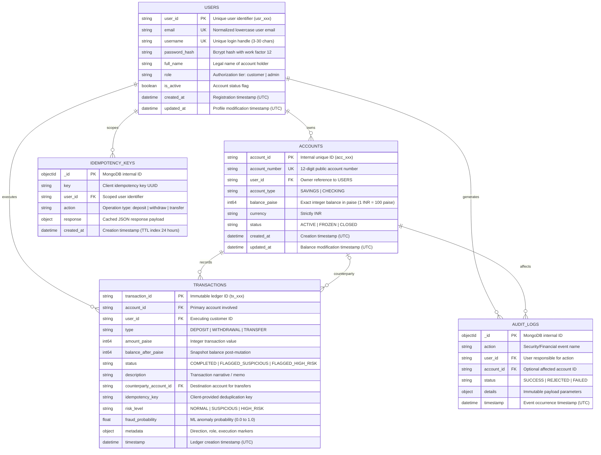

# Database Design & Persistence Specification
## Apex Bank Core Banking Database

**Database Management System:** MongoDB 8.0 Enterprise / Community  
**Cluster Architecture:** Single-Node Replica Set (`rs0`) with Multi-Document ACID Transactions  
**Connection URI:** `mongodb://127.0.0.1:27017/?replicaSet=rs0&directConnection=true`  
**Database Name:** `banking_dev` (Development) / `banking_test` (Isolated Test Runner)  

---

## 1. Database Entity-Relationship Diagram

---

## 2. Detailed Collection Schemas

### 2.1 Collection: `users`
Stores user profile, credentials, and authorization roles.
- **Indexes**:
  - `{"email": 1}`: Unique index (`name: "uniq_user_email"`).
  - `{"username": 1}`: Unique index (`name: "uniq_user_username"`).
  - `{"user_id": 1}`: Unique index (`name: "uniq_user_id"`).
  - `{"role": 1}`: Standard index for role-based queries.

### 2.2 Collection: `accounts`
Stores bank accounts, account numbers, and atomic balance balances.
- **Indexes**:
  - `{"account_id": 1}`: Unique index (`name: "uniq_account_id"`).
  - `{"account_number": 1}`: Unique index (`name: "uniq_account_number"`).
  - `{"user_id": 1}`: Query index for fetching a customer's accounts.
  - `{"status": 1}`: Filter index for active accounts.
- **Critical Invariant**:
  - `balance_paise` is stored as an exact 64-bit integer. Floating-point values are strictly rejected.

### 2.3 Collection: `transactions`
Immutable double-entry financial ledger recording all deposits, withdrawals, and transfers.
- **Indexes**:
  - `{"transaction_id": 1}`: Unique index (`name: "uniq_tx_id"`).
  - `{"account_id": 1}`: Query index for account ledgers.
  - `{"user_id": 1}`: Query index for user transaction history.
  - `{"timestamp": -1}`: Index for chronological pagination.
  - `{"account_id": 1, "timestamp": -1}`: Compound index for account ledger sorting.
  - `{"risk_level": 1}`: Query index for flagged transactions queue.

### 2.4 Collection: `idempotency_keys`
Caches successful mutation payloads to prevent duplicate execution upon network retries.
- **Indexes**:
  - `{"key": 1, "user_id": 1}`: Unique compound index (`name: "uniq_idem_key_user"`).
  - `{"created_at": 1}`: **TTL Index** (`expireAfterSeconds: 86400`). MongoDB background thread automatically purges keys older than 24 hours.

### 2.5 Collection: `audit_logs`
Immutable compliance and security log capturing user logins, account creation, and rejected overdraft attempts.
- **Indexes**:
  - `{"timestamp": -1}`: Chronological log querying.
  - `{"user_id": 1}`: User security auditing.
  - `{"action": 1}`: Action-based filtering.

---

## 3. ACID Transactions & Concurrency Strategy

1. **Replica Set Configuration**: Multi-document transactions require MongoDB to operate as a replica set (`rs0`).
2. **Transaction Isolation**: MongoDB transactions use snapshot isolation level. Reads inside the transaction only see committed data as of the transaction start.
3. **Optimistic Locking & Transient Error Handling**:
   - Write operations conditional on account balance (e.g. `{"balance_paise": {"$gte": amount}}`) protect against overdrafts.
   - Concurrent writes on the same document trigger `WriteConflict` (`TransientTransactionError`), which is captured and automatically retried with exponential backoff and jitter up to 25 attempts.
