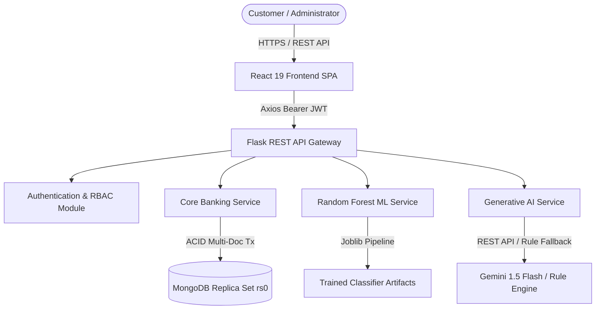

# Software Requirements Specification (SRS)
## AI-Enhanced Core Banking Platform (Apex Bank)

**Document Version:** 1.0.0  
**Status:** Approved / Release Baseline  
**Project:** Apex Bank Core Banking & AI Financial Platform  

---

## 1. Introduction

### 1.1 Purpose
This Software Requirements Specification (SRS) details the complete functional, non-functional, behavioral, and architectural requirements for the **Apex Bank AI-Enhanced Banking Application**. It serves as the formal specification for system validation, security audits, and lifecycle maintenance.

### 1.2 Scope of the System
Apex Bank is an enterprise-grade core banking application designed to deliver:
1. **Core Banking Operations**: Atomic multi-document ACID financial transactions (deposits, withdrawals, transfers) with strict overdraft prevention, integer-paise accounting, and idempotency guarantees.
2. **Security & Role-Based Access**: Multi-tier authentication with Bcrypt hashing, signed JWT session tokens, and strict role segregation between Customers and Administrators.
3. **Machine Learning Fraud Detection**: Real-time anomaly and fraud probability scoring on transactions powered by a tuned Random Forest classifier.
4. **Generative AI Financial Assistant**: Context-aware personal financial management providing monthly cash flow summaries, spending pattern analysis, savings runway recommendations, and an interactive assistant with security refusal guardrails.
5. **Modern Reactive Frontend**: A high-performance responsive web interface built on React 19, Tailwind CSS, Lucide icons, and Recharts.

---

## 2. Overall Description

### 2.1 Product Perspective
Apex Bank operates as a distributed web client-server application backed by a MongoDB replica set cluster (`rs0`) for ACID transactions, a Python/Flask REST API tier, and a client-side Single Page Application (SPA).

### 2.2 User Classes and Roles
1. **Customer (`role: "customer"`)**:
   - Register and manage personal bank accounts (Savings, Checking).
   - Perform deposits, withdrawals, and inter-account fund transfers.
   - Inspect personal transaction ledger with pagination, type, and risk filtering.
   - Run simulated transaction risk evaluations on personal accounts.
   - Interact with the AI Financial Assistant for monthly summaries, spending insights, and budgeting advice.
2. **Administrator (`role: "admin"`)**:
   - Provision new administrator credentials.
   - Audit all bank accounts across all system customers.
   - Inspect system-wide flagged transactions (Suspicious & High-Risk queue).
   - Review ML evaluation metrics, confusion matrix, and feature importances.
   - Access system health diagnostics and replication cluster status.

---

## 3. Specific Functional Requirements

### 3.1 Authentication & Security (AUTH)
- **AUTH-01 (Password Hashing)**: All passwords must be salted and hashed using Bcrypt with a work factor $\ge 12$. Passwords must never be stored, logged, or serialized in plaintext.
- **AUTH-02 (Password Complexity)**: Passwords must be at least 8 characters long and contain at least one alphabetical letter and one numeric digit.
- **AUTH-03 (JWT Session Tokens)**: Successful authentication must issue a cryptographically signed HMAC-SHA256 JWT access token containing user identity and role.
- **AUTH-04 (Role-Based Access Control)**: Endpoints marked with `@roles_required("admin")` must reject customer tokens with HTTP 403 Forbidden.
- **AUTH-05 (Privilege Escalation Prevention)**: Public registration must unconditionally force `role="customer"`, stripping any administrative role parameters.
- **AUTH-06 (IDOR Safeguards)**: Customers must only access accounts and transactions that they own. Unauthorized cross-user requests must return HTTP 403 Forbidden.

### 3.2 Core Banking Engine (BANK)
- **BANK-01 (Integer Paise Precision)**: All monetary values must be stored, computed, and transferred strictly as integer paise ($1\text{ INR} = 100\text{ paise}$). Floating-point balances are strictly prohibited in the persistence layer.
- **BANK-02 (Atomic Overdraft Prevention)**: Withdrawals and transfers must use conditional atomic balance guards (`{"balance_paise": {"$gte": amount_paise}}`). Balances must never drop below zero under any concurrency condition.
- **BANK-03 (ACID Multi-Document Atomicity)**: Inter-account fund transfers must atomically debit the source account, credit the target account, and write dual ledger entries inside a MongoDB replica set transaction.
- **BANK-04 (Idempotency Protection)**: Financial mutations must accept an optional `Idempotency-Key` header. Duplicate requests must return the identical cached result without re-executing transactions.
- **BANK-05 (Immutable Ledger & Invariant Consistency)**: Every balance mutation must write an immutable audit transaction record. The sum of all ledger events must exactly match the account balance.

### 3.3 Machine Learning Fraud Detection (ML)
- **ML-01 (Real-Time Inference)**: Every deposit, withdrawal, and transfer must be scored by the ML inference pipeline.
- **ML-02 (Feature Extraction)**: Features including transaction velocity, amount-to-average ratio, balance ratio, and nocturnal timing must be computed dynamically.
- **ML-03 (Risk Classification)**: Transactions must be categorized into:
  - `NORMAL`: Probability $< 0.25$
  - `SUSPICIOUS`: $0.25 \le \text{Probability} < 0.70$
  - `HIGH_RISK`: $\text{Probability} \ge 0.70$
- **ML-04 (Admin Metrics Endpoint)**: Administrators must be able to inspect model accuracy, precision, recall, F1-score, and ROC-AUC via dedicated APIs.

### 3.4 Generative AI Financial Assistant (AI)
- **AI-01 (Monthly Financial Summary)**: Calculate mathematically exact monthly inflows, outflows, net cash flow, and month-over-month deltas.
- **AI-02 (Spending Velocity & Outlier Analysis)**: Analyze spending cadence and flag high-value debit outliers without assuming non-existent expense categories.
- **AI-03 (Conservative Savings Recommendations)**: Provide realistic emergency fund runway targets based strictly on actual cash flow.
- **AI-04 (Transaction Execution Guardrail)**: The chatbot must strictly reject prompt injection attempts to transfer or withdraw funds.
- **AI-05 (PII Data Masking)**: 12-digit account numbers must be masked (e.g., `100****0523`) before inclusion in LLM prompt contexts.
- **AI-06 (Deterministic Fallback)**: In the absence of an external LLM API key, the system must seamlessly fall back to rule-based financial advice without raising errors.
- **AI-07 (Sliding-Window Rate Limiting)**: Limit users to 30 AI requests per minute to prevent resource exhaustion.

---

## 4. Non-Functional Requirements

### 4.1 Security Requirements
- **NFR-SEC-01**: Secure HTTP headers (`X-Content-Type-Options: nosniff`, `X-Frame-Options: DENY`, `X-XSS-Protection: 1; mode=block`, `Referrer-Policy: strict-origin-when-cross-origin`) must be applied to all responses.
- **NFR-SEC-02**: Production client bundles must contain zero API keys, database connection strings, or administrative credentials.
- **NFR-SEC-03**: Environment configuration `.env` and runtime data must be excluded from version control.

### 4.2 Reliability & Concurrency Requirements
- **NFR-REL-01**: The system must sustain concurrent transactions on the same account without data loss or race conditions using automated transaction retry with jitter.
- **NFR-REL-02**: In the event of a network or system failure during a multi-document transfer, MongoDB transaction rollback must ensure neither account balance is corrupted.

### 4.3 Performance Requirements
- **NFR-PERF-01**: Core banking balance checks and atomic deposits/withdrawals must execute with latency $< 50\text{ ms}$.
- **NFR-PERF-02**: ML model inference must execute in $< 10\text{ ms}$ per transaction.
- **NFR-PERF-03**: Frontend production bundles must be code-split and load in $< 2\text{ seconds}$ on broadband connections.
