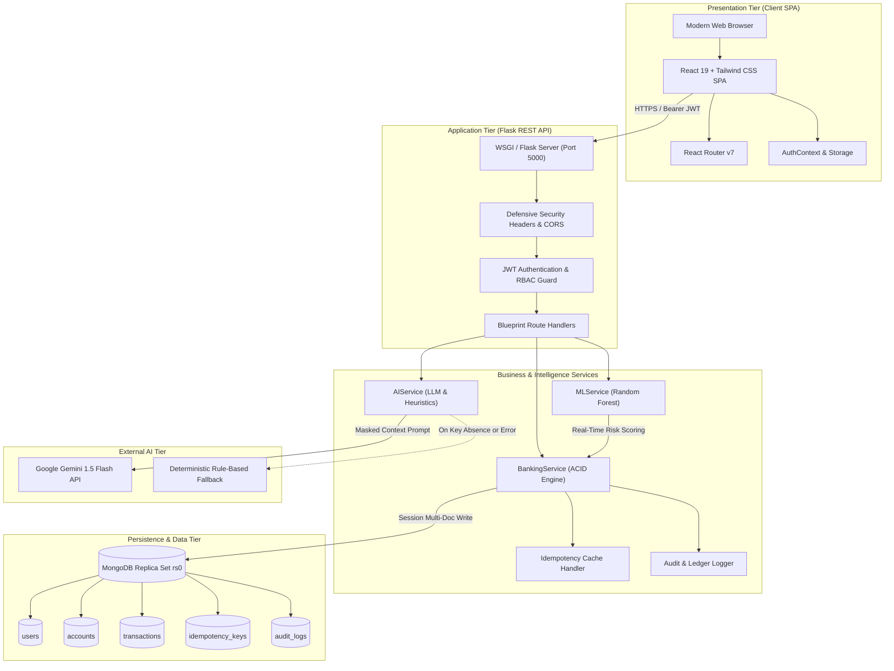
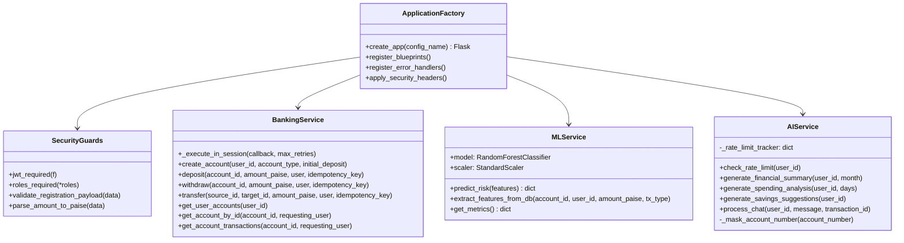
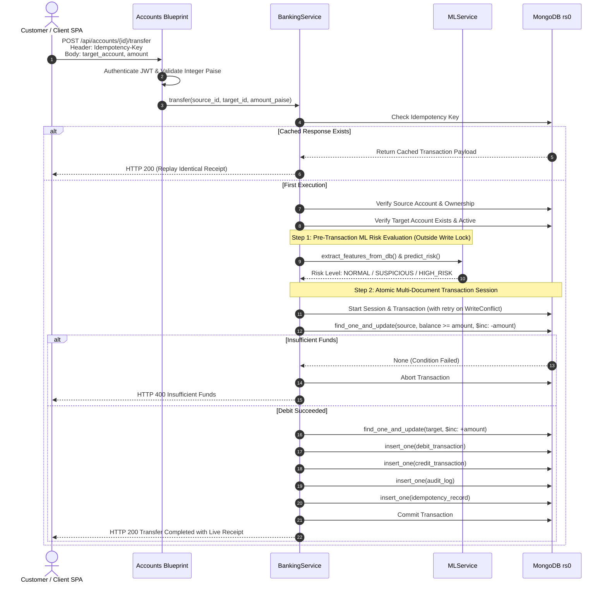
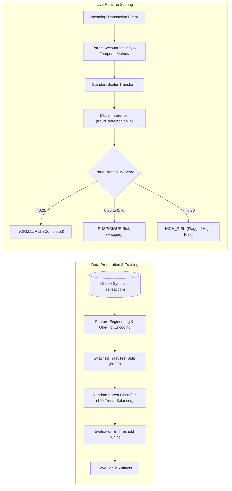
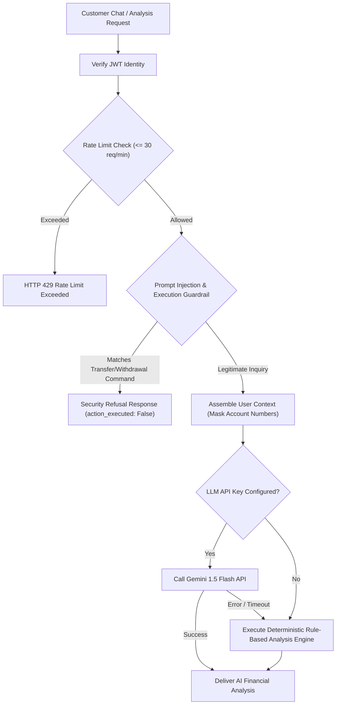

# System Design Document (SDD)
## AI-Enhanced Core Banking Platform (Apex Bank)

**Document Version:** 1.0.0  
**Status:** Approved  
**Classification:** Technical Architecture & Design Specification  

---

## 1. High-Level System Architecture

Apex Bank is engineered as a decoupled, multi-tier system separating the presentation, business logic, intelligence, and distributed persistence layers.



---

## 2. Backend Module Architecture

The Flask backend is organized into micro-modular components adhering to single-responsibility principles:



---

## 3. End-to-End Banking Transaction Workflow

Every balance mutation enforces atomic validation, pre-lock ML risk scoring, conditional update guards, double-entry ledger persistence, and transaction rollback.



---

## 4. Machine Learning Fraud Detection Pipeline

The machine learning system classifies transaction anomalies in real-time to alert users and administrators before fraud propagates.



### Feature Engineering Matrix
1. `time_since_last_tx_min`: Time interval in minutes since account's previous activity.
2. `amount_to_avg_ratio`: Ratio of current transaction amount to customer's historical average.
3. `amount_inr`: Exact transaction value in Indian Rupees.
4. `balance_before_inr`: Account balance prior to operation.
5. `balance_ratio`: Ratio of transaction amount to account balance ($\text{amount} / \text{balance}$).
6. `tx_frequency_last_24h`: Number of transactions recorded on the account in past 24 hours.
7. `is_rapid_succession`: Binary flag indicating transactions occurring within 3 minutes of previous activity.
8. `is_weekend`: Binary flag for weekend operations.
9. `hour_of_day`: Hour (0-23) indicating nocturnal vs daytime activity.
10. `tx_type`: Categorical encoded transaction type (DEPOSIT, WITHDRAWAL, TRANSFER).

---

## 5. Generative AI Financial Assistant Pipeline



---

## 6. Concurrency & ACID Integrity Design

### 6.1 Transaction Retry Loop with Backoff
When multiple concurrent requests target the same account, MongoDB replica set transactions experience `TransientTransactionError` (code 112 `WriteConflict`). Apex Bank implements an automated retry wrapper:
- **Max Retries**: 25 iterations.
- **Backoff Algorithm**: $\text{delay} = 0.01 \times (\text{attempt} + 1) + \text{random}(0.01, 0.05)$.
- **Write Lock Minimization**: Heavy read queries and ML feature extraction are executed *before* entering the transaction, ensuring write transactions commit in $< 1\text{ ms}$.

### 6.2 Overdraft Prevention Guarantee
Balances cannot drop below zero under any concurrency condition because updates are conditioned at the database engine level:
```json
{
  "account_id": "acc_123",
  "status": "ACTIVE",
  "balance_paise": { "$gte": 50000 }
}
```
If two simultaneous transactions each attempt to debit 500.00 INR when the balance is 500.00 INR, the database guarantees that exactly one matches the filter. The second fails atomically without race conditions.
